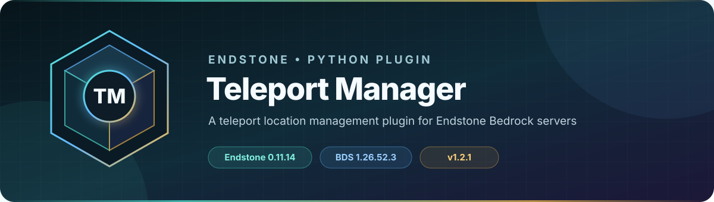

[Download compatibility release v1.2.3](https://github.com/TheNINJALLO/endstone-teleport-plugin/releases/tag/v1.2.3).

> Compatibility update **1.2.3** targets **Endstone 0.11.16 / BDS 1.26.65.1**, protocol **2225**, Python **3.11+**. API level remains **0.11**. Keep configuration and player data when replacing the wheel. Earlier acceptance records below describe their original builds; current qualification is tracked in the workspace upgrade report.

<!-- endstone-professional-header:start -->
<p align="center">
  
</p>

<p align="center">
  <a href="https://github.com/TheNINJALLO/endstone-teleport-plugin/actions/workflows/wheel-release.yml"></a>
  <a href="https://github.com/TheNINJALLO/endstone-teleport-plugin/releases/latest"></a>
</p>

<p align="center">
  
  
  
  =3.11" src="https://img.shields.io/badge/Python-%3E=3.11-3776AB?style=flat-square&amp;logo=python&amp;logoColor=white">
</p>

<p align="center">
  <strong>A teleport location management plugin for Endstone Bedrock servers.</strong>
</p>

<p align="center">
  <a href="#what-it-does">What it does</a> &bull;
  <a href="#how-to-use">How to use</a> &bull;
  <a href="#commands-and-permissions">Commands</a> &bull;
  <a href="#install">Install</a> &bull;
  <a href="https://github.com/TheNINJALLO/endstone-teleport-plugin/releases">Releases</a>
</p>

## Overview

A teleport location management plugin for Endstone Bedrock servers. This release is aligned with Endstone 0.11.14 and Minecraft Bedrock Dedicated Server 1.26.52.3, and is distributed as a Python wheel for direct installation in an Endstone server.

## What it does

- Turns tagged NPC/entity interactions into form-based teleport menus.
- Stores multiple named destinations under each active entity tag.
- Provides operator commands for tag registration and configuration reloads.

## How to use

1. Register a logical portal tag with `/tptag add <tag>`.
2. Apply it to the intended entity with Bedrock's `/tag` command, then interact with that entity as an operator to configure destinations.
3. Players interact with the tagged entity and select a saved location from the form.
4. Use `/tptag list` to audit active tags and `/tpreload` after manual JSON edits.

## Commands and permissions

| Command / usage | What it does | Access |
|---|---|---|
| `/tptag list`<br>`/tptag add <tag: str>`<br>`/tptag remove <tag: str>` | Manage teleport entity tags | `teleport.admin` |
| `/tpreload` | Reload teleport configuration from file | `teleport.admin` |

## Compatibility

| Component | Supported version |
|---|---|
| Endstone | `0.11.14` |
| Endstone API | `0.11` |
| Bedrock Dedicated Server | `1.26.52.3` |
| Python | `>=3.11` |
| Plugin release | `v1.2.2` |

## Install

Download the wheel from the matching GitHub release:

```bash
gh release download v1.2.3 --repo TheNINJALLO/endstone-teleport-plugin --pattern "*.whl"
```

Copy the downloaded wheel into the server's `plugins/` directory, remove any older wheel for the same plugin, and restart Endstone.

> [!IMPORTANT]
> Use Endstone `0.11.14` with BDS `1.26.52.3`. Back up worlds and plugin data before upgrading a production server.

## Configuration and secrets

Runtime databases, logs, local `.env` files, server directories, and root `config.toml` files are excluded from source releases. When an example configuration is provided, copy it locally and keep live tokens, passwords, webhook URLs, and server identifiers out of Git.

## Release automation

Every `v*` tag runs [the wheel release workflow](.github/workflows/wheel-release.yml), builds the package in a clean GitHub runner, stores the wheel as a workflow artifact, and attaches it to the matching GitHub release.
<!-- endstone-professional-header:end -->
